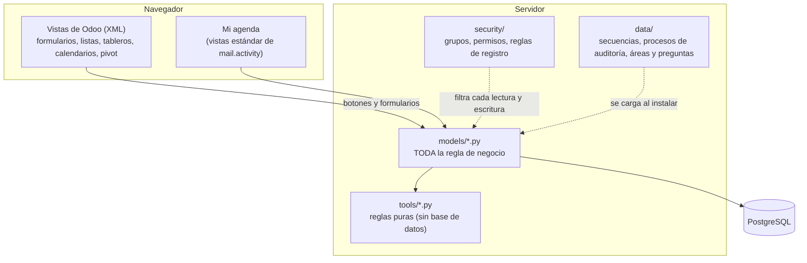
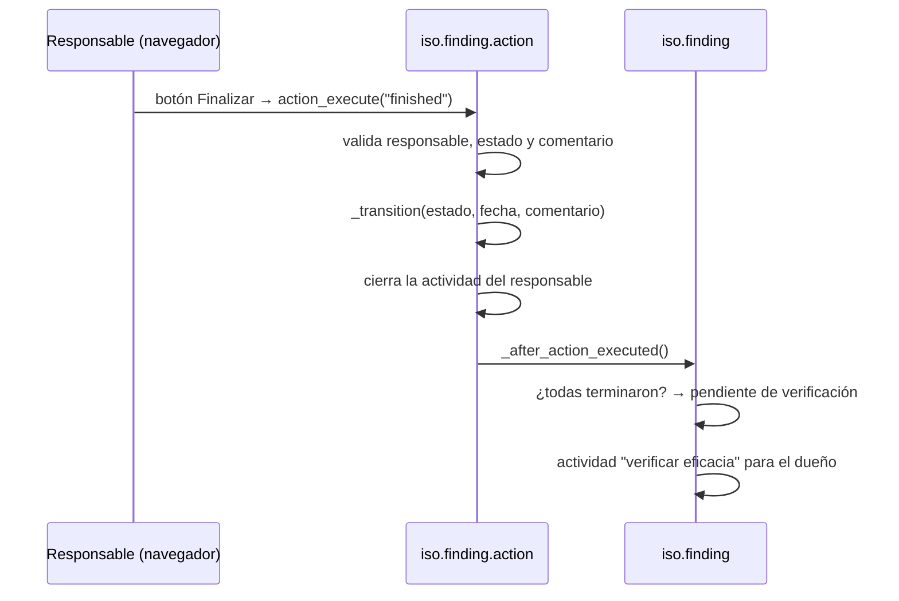

# Arquitectura

## Las capas

**Regla de oro: la lógica vive en los modelos.** Las vistas solo muestran datos y disparan métodos
(`action_*`). Cada método valida por su cuenta quién lo llama y en qué estado está el registro, así da igual si la
orden viene de un botón, de una llamada RPC armada a mano o de otro método: las reglas se cumplen igual.
Los tests de `tests/test_review_findings.py` y de cada flujo prueban justamente eso, actuando como usuarios
distintos (`with_user`).

**No hay JavaScript propio.** Todo es vista estándar de Odoo; ver `docs/UI.md` en la raíz del repositorio.

## Qué hay en cada carpeta

| Carpeta / archivo | Contenido |
|---|---|
| `models/iso_abstract_workflow.py` | **Mixin** común (`iso.workflow.mixin`): `_is_iso_admin`, `_transition`, `_check_protected`. El nombre empieza con `iso_abstract` para que Odoo lo cargue primero. |
| `models/iso_finding.py` | Hallazgo: estados, secuencias `H-`/`M-`, texto de "próximo paso", acciones de análisis y cierre. |
| `models/iso_finding_action.py` | Acción de un hallazgo: informe de implementación, verificación, re-planificación. |
| `models/iso_special_release.py`, `iso_special_release_approval.py`, `iso_special_release_wizard.py` | Liberación especial, sus 4 firmas, la confirmación de Posventa y el asistente de acciones vinculadas. |
| `models/iso_change_request.py` | Solicitud de cambio, áreas/preguntas (datos), revisiones sectoriales, líneas del cuestionario y asistente de acciones. |
| `models/iso_calendar.py` | Calendario, tareas, líneas de auditoría (oportunidades y no conformidades) y la regla de bloqueo de auditorías. |
| `models/iso_calendar_wizard.py` | Asistente de planificación anual y de compartir una auditoría. |
| `models/iso_audit_process.py` | Procesos de auditoría, plantillas de actividades rutinarias y el alcance de auditoría por empresa. |
| `tools/approvals.py`, `calendar_rules.py`, `reminders.py` | **Reglas puras** (sin ORM): estado de una LE/SC, fechas por frecuencia, hitos de recordatorio. Se testean sin base. |
| `tools/documentacion.py` | Genera `docs/referencia.md` desde el ORM. |
| `security/` | `iso_security.xml` (grupos), `ir.model.access.csv` (permisos), `iso_rules.xml` (reglas de registro). |
| `data/` | Secuencias, 12 procesos de auditoría (47 entregables), 10 actividades rutinarias, 8 áreas y 74 preguntas de cambio. Generados desde la aplicación anterior; los editan los administradores. |
| `views/` | Formularios, listas, kanban, calendarios, pivot, buscadores, asistentes y menús. |
| `i18n/` | `iso_sgc.pot` (plantilla) y `es_AR.po`. |
| `tests/` | Un archivo por proceso, más seguridad, interfaz, traducción, documentación y capturas (opcional). |

## Decisiones de diseño (y por qué)

1. **Un patrón único de transición.** Los campos de estado nunca se escriben directo. El método del flujo valida,
   y escribe con `_transition(vals)` (ejecuta con `sudo()` y marca el contexto `iso_transition`). El `write()` de
   cada modelo llama a `_check_protected` para rechazar escrituras directas de no administradores. Así hay *un*
   lugar para auditar quién puede cambiar qué.
2. **Estados derivados, no guardados a mano.** `pending_user_ids` (quién tiene algo pendiente) se calcula a partir
   de las acciones; la aplicación anterior mantenía arreglos que había que sincronizar manualmente.
3. **Notificaciones = actividades + chatter.** Cada responsable recibe una *actividad* con fecha límite; se
   completa sola al actuar. Reemplaza a la colección de notificaciones, al webhook de correo y a casi todo el cron.
   *Mi agenda* es una vista estándar sobre esas actividades.
4. **Datos de negocio como datos.** Procesos de auditoría, preguntas de cambio y actividades rutinarias son
   registros editables, no listas en el código. Cada solicitud de cambio guarda **su copia** de las preguntas.
5. **Reglas puras separadas.** Lo que se puede decidir sin base de datos (estado de una LE, fechas de una
   frecuencia, hito de recordatorio) está en `tools/` y se prueba sin instalar nada.
6. **Sin módulos de la comunidad (OCA).** `base_tier_validation` no existe para Odoo 19 y `mgmtsystem` no encaja
   con el flujo (exige un contacto en cada no conformidad y no modela la verificación por acción). Menos
   dependencias que portar en cada versión mayor de Odoo.
7. **Multiempresa nativo.** Cada registro lleva `company_id` y una regla global lo aísla; la numeración es única
   entre empresas.

## Cómo viaja un pedido (ejemplo: el responsable finaliza una acción)

