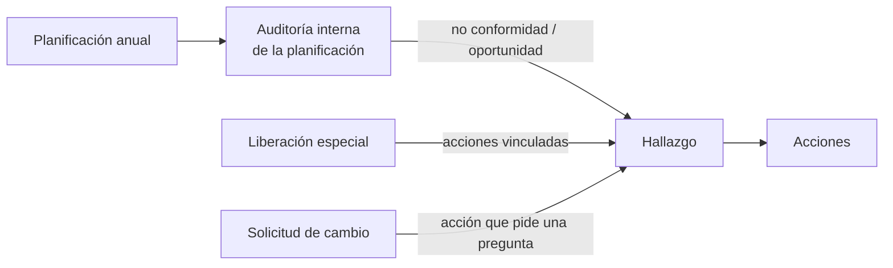

# Conceptos

El módulo digitaliza lo que antes se hacía con planillas y correos en el área de Calidad. Este documento explica
el negocio con palabras simples; los términos técnicos de Odoo están en [odoo.md](odoo.md).

## Glosario

| Término | Qué es |
|---|---|
| **SGC** | Sistema de Gestión de la Calidad (la norma ISO 9001:2015 y los documentos propios). |
| **Hallazgo** | Algo que se encontró mal (**no conformidad**, hallazgo *correctivo*) o una idea para hacer mejor (**mejora**). Se numera `H-0001` (correctivos) y `M-0001` (mejoras): son series **independientes**. |
| **Dueño** | Quien registra el hallazgo y verifica al final que las acciones sirvieron. |
| **Responsable del análisis** | Quien investiga la causa raíz. Solo en hallazgos correctivos. |
| **Acción** | Algo concreto a hacer, con responsable y fecha límite. Puede terminar *finalizada*, *cancelada* o *rechazada*. |
| **Verificación de eficacia** | El dueño confirma, acción por acción, que lo hecho resolvió el problema. |
| **Liberación especial (LE)** | Autorización para usar/entregar algo que se desvió de lo especificado (materia prima o producto terminado). Se numera `LE-0001`. |
| **Firma** | La aprobación o el rechazo de un área (Calidad, Ingeniería, Comercial u Operaciones) sobre una LE. |
| **Posventa** | Área que debe *confirmar la recepción* de la LE; sin eso no queda aprobada. |
| **Solicitud de cambio (SC)** | Propuesta de cambiar algo (proceso, producto, equipamiento). Pasa por revisiones de 8 áreas y una aprobación final. Se numera `SC-0001`. |
| **Revisión sectorial** | El cuestionario que completa cada área afectada por una SC. |
| **Planificación anual** | El calendario del año: 48 auditorías internas (12 procesos × T1–T4) más las actividades rutinarias del SGC. |
| **Auditoría interna** | Una tarea de la planificación con campos extra: alcance, criterios, fortalezas, oportunidades y no conformidades. |
| **Actividad (Odoo)** | Una tarea pendiente de una persona sobre un registro, con fecha límite. Es lo que alimenta *Mi agenda*. |

## Cómo se relacionan los procesos

Los hallazgos son el punto de encuentro: tres procesos distintos pueden generar uno, y todos siguen el mismo
circuito de análisis → acciones → verificación.

## Reglas que conviene tener presentes

- **Nada cambia de estado "a mano".** Los estados avanzan con los botones del flujo, que validan quién puede
  hacerlo (ver [seguridad](seguridad.md)).
- **Las áreas decidimos nosotros, no el sistema:** el módulo no calcula "quién debería aprobar", solo exige
  que cada área asignada firme.
- **Lo que no aplica se aprueba solo** en las solicitudes de cambio: las áreas sin marcar quedan aprobadas.
- **Una auditoría finalizada queda bloqueada** para su responsable; solo un administrador puede reabrirla.
