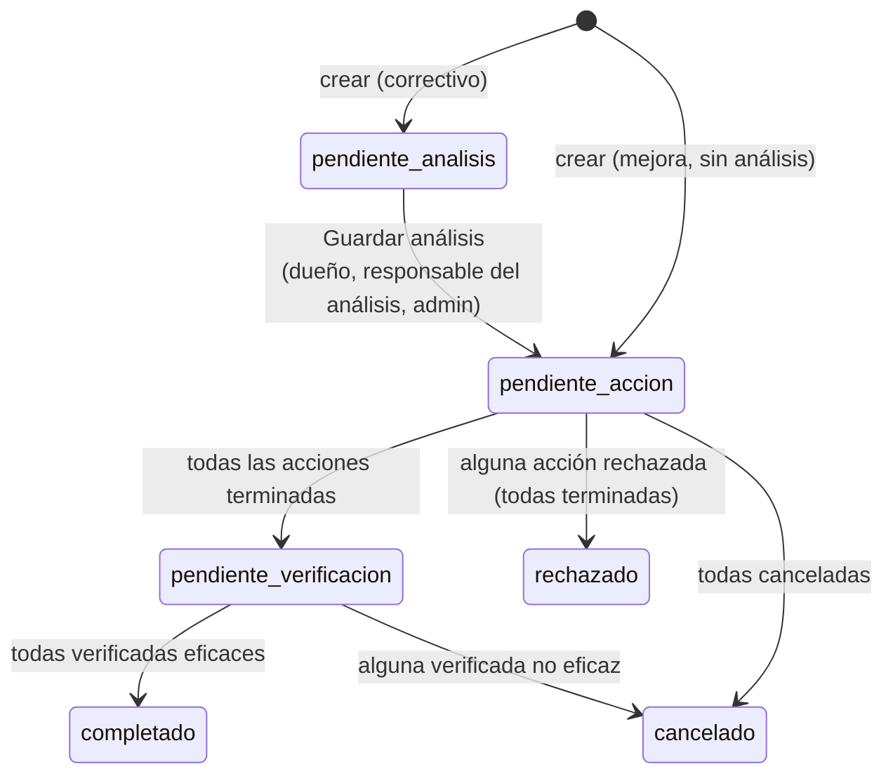
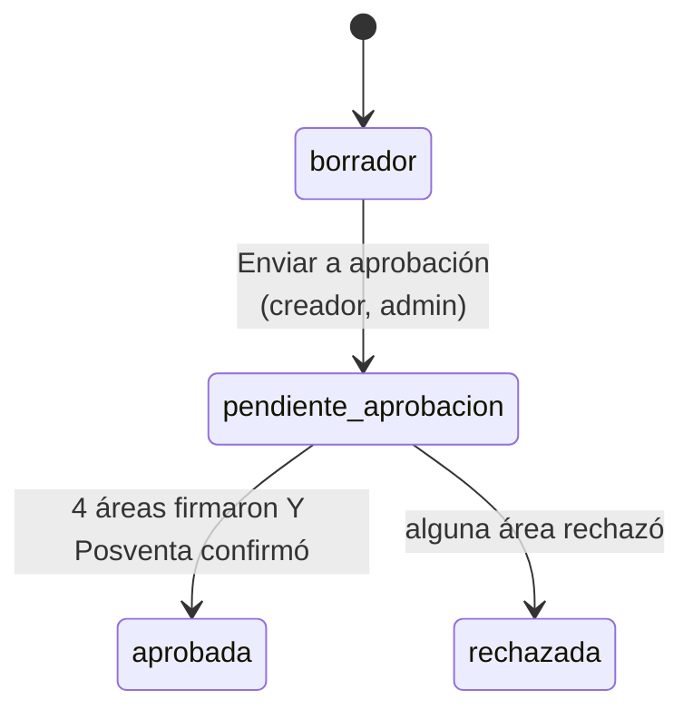
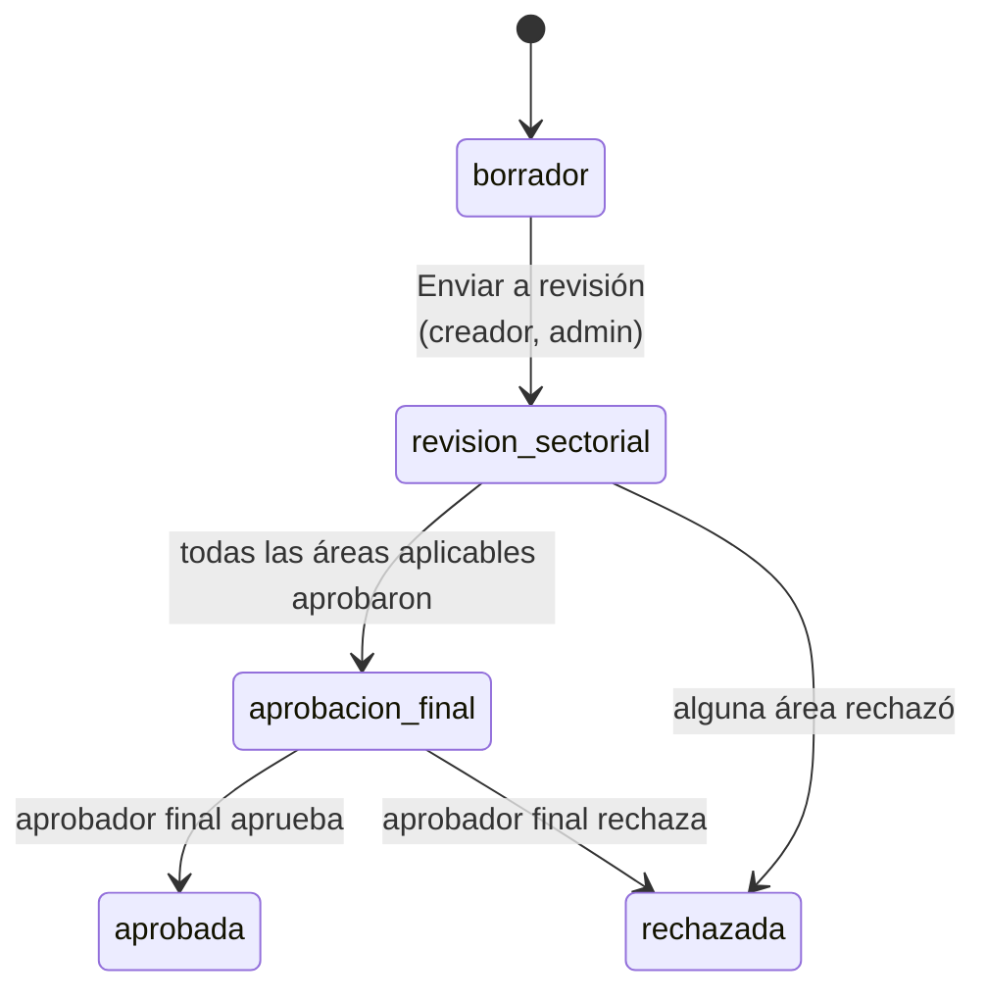
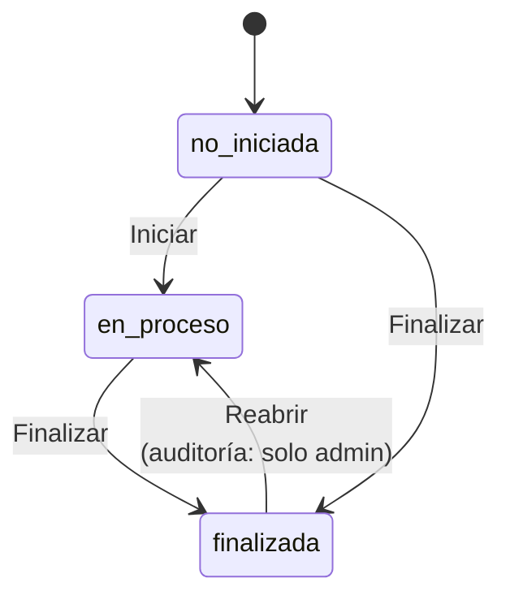

# Flujos

Cada flujo avanza **solo** con los botones indicados. Entre paréntesis, quién puede usarlos.

## Hallazgo y acciones

| Quién | Qué | Condición |
|---|---|---|
| Responsable del análisis (correctivo) o dueño (mejora) | Agregar acciones | Hallazgo *pendiente de acción*; fecha límite no pasada |
| Responsable de la acción | **Finalizar / Cancelar / Rechazar** con informe | Acción pendiente; el comentario es obligatorio |
| Dueño | **Eficaz / No eficaz** por acción finalizada | Una vez por acción |

Una acción *cancelada* no necesita verificación y no impide cerrar. Si **todas** se cancelan, el hallazgo queda *cancelado*.

## Liberación especial

- Cada área activa debe tener aprobador; **Comercial no puede excluirse**. Posventa es obligatorio.
- La firma la da solo el aprobador asignado (o un admin); **rechazar exige comentario**.
- Un administrador puede corregir una firma una vez enviada.
- En borrador, el creador puede agregar acciones: cada una crea un hallazgo ya *pendiente de acción*.
- Borrar una LE (solo admin) borra también sus hallazgos vinculados.

## Solicitud de cambio

1. **Borrador:** el creador completa la propuesta, marca las áreas que aplican, elige revisor de cada una y fija la fecha límite.
2. **Revisión:** cada revisor responde *Aplica* (Sí/No/N/A) y, si es Sí, *Requiere acción*. Cada acción requerida se crea desde su fila.
   Solo el revisor asignado decide (ni siquiera un admin; un admin puede *reasignar* al revisor).
   **Aprobar** exige todo respondido y todas las acciones creadas; **rechazar** no exige nada.
3. **Aprobación final:** el creador (o un admin) designa al aprobador y la fecha; solo ese aprobador decide.
4. **Comunicación:** al decidir, se avisa a creador, aprobador y revisores y queda registrado.

## Planificación anual y auditorías

- El asistente (solo admin) genera las tareas: auditorías trimestrales (15 mar/jun/sep/dic) y actividades por frecuencia
  (anual 30 nov; semestral 30 jun y 15 dic; trimestral fin de trimestre; mensual el 28).
- **Finalizar** exige comentario; en una auditoría, además *personal auditado* y que la conclusión no conserve los `[textos entre corchetes]` de la plantilla.
- Una **auditoría finalizada** queda bloqueada para su responsable.
- **Desde una auditoría:** una *oportunidad* genera un hallazgo de mejora (con su acción); una *no conformidad* menor/mayor genera un hallazgo correctivo pendiente de análisis. Cada ítem se vincula una sola vez.
- **Compartir** una auditoría da acceso de lectura a los usuarios elegidos y avisa; los correos externos reciben el aviso pero no acceso.
- Las auditorías solo las ven el administrador, su responsable y a quienes se les compartió.
