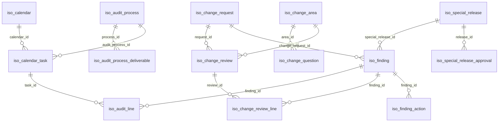

# Referencia generada del módulo ISO SGC

> Archivo generado por `tools/documentacion.py`: no editar a mano. Cómo regenerarlo: ver el encabezado de ese archivo.

## Diagrama de datos

## Modelos y campos

### `iso.activity.template`
ISO routine activity template.

| Campo | Tipo | Etiqueta | Notas |
|---|---|---|---|
| `active` | boolean | Active |  |
| `frequency` | selection | Frequency | obligatorio; valores: `annual`, `semester`, `quarterly`, `monthly` |
| `name` | char | Name | obligatorio |
| `sequence` | integer | Sequence |  |

### `iso.audit.line`
ISO audit finding line.

| Campo | Tipo | Etiqueta | Notas |
|---|---|---|---|
| `can_confirm` | boolean | Can Confirm | calculado |
| `date_deadline` | date | Deadline |  |
| `finding_id` | many2one → `iso.finding` | Finding |  |
| `kind` | selection | Kind | obligatorio; valores: `opportunity`, `minor`, `major` |
| `process` | char | Originating process |  |
| `task_id` | many2one → `iso.calendar.task` | Task | obligatorio |
| `text` | text | Text | obligatorio |
| `user_id` | many2one → `res.users` | Responsible |  |

### `iso.audit.process`
ISO audit process.

| Campo | Tipo | Etiqueta | Notas |
|---|---|---|---|
| `active` | boolean | Active |  |
| `clauses` | text | Clauses |  |
| `deliverable_ids` | one2many → `iso.audit.process.deliverable` | Deliverables |  |
| `name` | char | Name | obligatorio |
| `objective` | text | Objective |  |
| `sequence` | integer | Sequence |  |

### `iso.audit.process.deliverable`
ISO audit process deliverable.

| Campo | Tipo | Etiqueta | Notas |
|---|---|---|---|
| `description` | text | Description |  |
| `evidence` | text | Evidence |  |
| `name` | char | Title | obligatorio |
| `process_id` | many2one → `iso.audit.process` | Process | obligatorio |
| `sequence` | integer | Sequence |  |

### `iso.calendar`
ISO annual planning.

| Campo | Tipo | Etiqueta | Notas |
|---|---|---|---|
| `company_id` | many2one → `res.company` | Company | obligatorio |
| `description` | text | Description |  |
| `done_count` | integer | Done Count | calculado |
| `name` | char | Name | obligatorio |
| `overdue_count` | integer | Overdue Count | calculado |
| `task_count` | integer | Task Count | calculado |
| `task_ids` | one2many → `iso.calendar.task` | Tasks |  |
| `year` | integer | Year | obligatorio |

### `iso.calendar.task`
ISO calendar task.

| Campo | Tipo | Etiqueta | Notas |
|---|---|---|---|
| `activity` | char | Activity |  |
| `audit_process_id` | many2one → `iso.audit.process` | Audited process |  |
| `audited_personnel` | char | Audited Personnel |  |
| `calendar_id` | many2one → `iso.calendar` | Calendar | obligatorio |
| `can_edit` | boolean | Can Edit | calculado |
| `comments` | text | Comments |  |
| `company_id` | many2one → `res.company` | Company | calculado y guardado; related `calendar_id.company_id` |
| `criteria` | text | Criteria |  |
| `date_completed` | date | Execution date |  |
| `date_deadline` | date | Deadline | obligatorio |
| `frequency` | selection | Frequency | obligatorio; valores: `annual`, `semester`, `quarterly`, `monthly` |
| `is_audit` | boolean | Internal audit |  |
| `is_overdue` | boolean | Is Overdue | calculado |
| `label` | char | Instance |  |
| `line_ids` | one2many → `iso.audit.line` | Audit findings |  |
| `name` | char | Name | obligatorio |
| `process_clauses` | text | Clauses | calculado; related `audit_process_id.clauses` |
| `process_deliverable_ids` | one2many → `iso.audit.process.deliverable` | Deliverables | calculado; related `audit_process_id.deliverable_ids` |
| `process_objective` | text | Objective | calculado; related `audit_process_id.objective` |
| `scope` | text | Scope |  |
| `shared_user_ids` | many2many → `res.users` | Shared with |  |
| `state` | selection | State | obligatorio; valores: `not_started`, `in_progress`, `done` |
| `strengths` | text | Strengths |  |
| `user_id` | many2one → `res.users` | Responsible | obligatorio |

### `iso.change.area`
ISO change request area.

| Campo | Tipo | Etiqueta | Notas |
|---|---|---|---|
| `active` | boolean | Active |  |
| `code` | char | Code | obligatorio |
| `name` | char | Name | obligatorio |
| `question_ids` | one2many → `iso.change.question` | Questions |  |
| `sequence` | integer | Sequence |  |

### `iso.change.question`
ISO change request question.

| Campo | Tipo | Etiqueta | Notas |
|---|---|---|---|
| `active` | boolean | Active |  |
| `area_id` | many2one → `iso.change.area` | Area | obligatorio |
| `name` | char | Question | obligatorio |
| `sequence` | integer | Sequence |  |

### `iso.change.request`
ISO change request.

| Campo | Tipo | Etiqueta | Notas |
|---|---|---|---|
| `can_decide_final` | boolean | Can Decide Final | calculado |
| `can_edit_definition` | boolean | Can Edit Definition | calculado |
| `can_review` | boolean | Can Review | calculado |
| `can_send_final` | boolean | Can Send Final | calculado |
| `communication_date` | datetime | Communication Date |  |
| `communication_notes` | text | Communication Notes |  |
| `communication_sent` | boolean | Communication Sent |  |
| `company_id` | many2one → `res.company` | Company | obligatorio |
| `creator_id` | many2one → `res.users` | Creator | obligatorio |
| `current_situation` | text | Current Situation | obligatorio |
| `description` | text | Proposal | obligatorio |
| `final_approver_id` | many2one → `res.users` | Final approver |  |
| `final_comments` | text | Final Comments |  |
| `final_date` | datetime | Final Date |  |
| `final_deadline` | date | Final approval deadline |  |
| `final_state` | selection | Final State | valores: `pending`, `approved`, `rejected` |
| `impact_analysis` | text | Impact Analysis | obligatorio |
| `linked_finding_ids` | one2many → `iso.finding` | Linked actions |  |
| `mission` | selection | Mission | obligatorio; valores: `safety`, `productivity`, `quality`, `costs`, `other` |
| `name` | char | Number |  |
| `next_step` | char | What's next | calculado |
| `objective` | text | Objective | obligatorio |
| `pending_review_count` | integer | Pending Review Count | calculado |
| `proposed_situation` | text | Proposed Situation | obligatorio |
| `review_deadline` | date | Review deadline |  |
| `review_ids` | one2many → `iso.change.review` | Sector reviews |  |
| `state` | selection | State | obligatorio; valores: `draft`, `pending_review`, `pending_approval`, `approved`, `rejected` |
| `title` | char | Title | obligatorio |

### `iso.change.review`
ISO change request sector review.

| Campo | Tipo | Etiqueta | Notas |
|---|---|---|---|
| `action_date` | datetime | Action Date |  |
| `action_missing_count` | integer | Action Missing Count | calculado |
| `applies` | boolean | Applicable |  |
| `area_id` | many2one → `iso.change.area` | Area | obligatorio |
| `can_decide` | boolean | Can Decide | calculado |
| `comments` | text | Comments |  |
| `date_deadline` | date | Deadline |  |
| `line_ids` | one2many → `iso.change.review.line` | Questionnaire |  |
| `request_id` | many2one → `iso.change.request` | Request | obligatorio |
| `request_state` | selection | Request status | calculado; related `request_id.state` |
| `state` | selection | State | obligatorio; valores: `pending`, `approved`, `rejected` |
| `unanswered_count` | integer | Unanswered Count | calculado |
| `user_id` | many2one → `res.users` | Reviewer |  |

### `iso.change.review.line`
ISO change request questionnaire line.

| Campo | Tipo | Etiqueta | Notas |
|---|---|---|---|
| `applies` | selection | Applies | valores: `yes`, `no`, `na` |
| `can_link` | boolean | Can Link | calculado |
| `finding_id` | many2one → `iso.finding` | Action |  |
| `name` | char | Question | obligatorio |
| `requires_action` | selection | Requires action | valores: `yes`, `no` |
| `review_id` | many2one → `iso.change.review` | Review | obligatorio |
| `sequence` | integer | Sequence |  |

### `iso.finding`
ISO finding.

| Campo | Tipo | Etiqueta | Notas |
|---|---|---|---|
| `action_ids` | one2many → `iso.finding.action` | Actions |  |
| `analysis_deadline` | date | Analysis Deadline |  |
| `analysis_summary` | text | Analysis Summary |  |
| `analysis_user_id` | many2one → `res.users` | Analysis responsible |  |
| `category` | selection | Category | obligatorio; valores: `corrective`, `improvement` |
| `change_request_id` | many2one → `iso.change.request` | Change request |  |
| `company_id` | many2one → `res.company` | Company | obligatorio |
| `contingency_actions` | text | Contingency Actions |  |
| `description` | text | Description | obligatorio |
| `finding_date` | date | Finding Date | obligatorio |
| `is_verified` | boolean | Is Verified |  |
| `name` | char | Number |  |
| `next_step` | char | What's next | calculado |
| `origin` | char | Origin | obligatorio |
| `owner_id` | many2one → `res.users` | Owner | obligatorio |
| `pending_user_ids` | many2many → `res.users` | Pending on | calculado y guardado |
| `process` | char | Process |  |
| `special_release_id` | many2one → `iso.special.release` | Special release |  |
| `state` | selection | State | obligatorio; valores: `pending_analysis`, `pending_action`, `pending_verification`, `completed`, `cancelled`, `rejected` |
| `type` | char | Type |  |
| `verification_date` | datetime | Verification Date |  |

### `iso.finding.action`
ISO finding action.

| Campo | Tipo | Etiqueta | Notas |
|---|---|---|---|
| `company_id` | many2one → `res.company` | Company | calculado y guardado; related `finding_id.company_id` |
| `date_deadline` | date | Deadline | obligatorio |
| `execution_date` | datetime | Execution Date |  |
| `finding_id` | many2one → `iso.finding` | Finding | obligatorio |
| `implementation_comment` | text | Implementation Comment |  |
| `name` | text | Description | obligatorio |
| `state` | selection | State | obligatorio; valores: `pending`, `finished`, `cancelled`, `rejected` |
| `user_id` | many2one → `res.users` | Responsible | obligatorio |
| `verification_comment` | text | Verification Comment |  |
| `verification_date` | datetime | Verification Date |  |
| `verification_state` | selection | Verification State | obligatorio; valores: `unverified`, `ok`, `nok` |

### `iso.special.release`
ISO special release.

| Campo | Tipo | Etiqueta | Notas |
|---|---|---|---|
| `approval_ids` | one2many → `iso.special.release.approval` | Approvals |  |
| `can_confirm_posventa` | boolean | Can Confirm Posventa | calculado |
| `can_sign` | boolean | Can Sign | calculado |
| `client_dealer` | char | Client / dealer |  |
| `client_impact` | text | Client impact / risks | obligatorio |
| `code` | char | Code |  |
| `company_id` | many2one → `res.company` | Company | obligatorio |
| `creator_id` | many2one → `res.users` | Creator | obligatorio |
| `date` | date | Date | obligatorio |
| `deviation_description` | text | Deviation Description | obligatorio |
| `linked_finding_ids` | one2many → `iso.finding` | Linked findings |  |
| `machine_model` | char | Machine Model |  |
| `material_description` | char | Material Description |  |
| `name` | char | Number |  |
| `next_step` | char | What's next | calculado |
| `of_number` | char | OF number |  |
| `posventa_confirmed` | boolean | Posventa Confirmed |  |
| `posventa_confirmed_date` | datetime | Posventa Confirmed Date |  |
| `posventa_user_id` | many2one → `res.users` | Posventa (notified) |  |
| `purchase_order_number` | char | Purchase Order Number |  |
| `release_type` | selection | Release Type | obligatorio; valores: `raw_material`, `finished_product` |
| `sales_note_number` | char | Sales Note Number |  |
| `state` | selection | State | obligatorio; valores: `draft`, `pending_approval`, `approved`, `rejected` |
| `vendor` | char | Vendor |  |

### `iso.special.release.approval`
ISO special release signature.

| Campo | Tipo | Etiqueta | Notas |
|---|---|---|---|
| `action_date` | datetime | Action Date |  |
| `area` | selection | Area | obligatorio; valores: `calidad`, `ingenieria`, `comercial`, `operaciones` |
| `can_evaluate` | boolean | Can Evaluate | calculado |
| `comments` | text | Comments |  |
| `excluded` | boolean | Excluded |  |
| `release_id` | many2one → `iso.special.release` | Release | obligatorio |
| `release_state` | selection | Release status | calculado; related `release_id.state` |
| `state` | selection | State | obligatorio; valores: `pending`, `approved`, `rejected` |
| `user_id` | many2one → `res.users` | Approver |  |

## Puntos de entrada

Métodos públicos (`action_*`, invocables por RPC o desde botones) y quién los usa. Los botones se buscan en `views/*.xml`; las llamadas de Python, por nombre en `models/`.

| Modelo | Método | Botones en vistas | Llamado desde |
|---|---|---|---|
| `iso.audit.line` | `action_confirm` | iso_calendar_views.xml | — |
| `iso.calendar.share.wizard` | `action_send` | iso_calendar_views.xml | — |
| `iso.calendar.task` | `action_finish` | iso_calendar_views.xml | — |
| `iso.calendar.task` | `action_insert_conclusion_template` | iso_calendar_views.xml | — |
| `iso.calendar.task` | `action_reopen` | iso_calendar_views.xml | — |
| `iso.calendar.task` | `action_start` | iso_calendar_views.xml | — |
| `iso.calendar.wizard` | `action_create` | iso_calendar_views.xml | — |
| `iso.change.line.action.wizard` | `action_confirm` | iso_change_request_views.xml | — |
| `iso.change.request` | `action_final_approve` | iso_change_request_views.xml | — |
| `iso.change.request` | `action_final_decision` | — | iso_change_request.py |
| `iso.change.request` | `action_final_reject` | iso_change_request_views.xml | — |
| `iso.change.request` | `action_open_my_review` | iso_change_request_views.xml | — |
| `iso.change.request` | `action_send_to_final_approval` | iso_change_request_views.xml | — |
| `iso.change.request` | `action_send_to_review` | iso_change_request_views.xml | — |
| `iso.change.review` | `action_approve` | iso_change_request_views.xml | — |
| `iso.change.review` | `action_date` | — | iso_change_request.py, iso_special_release_approval.py |
| `iso.change.review` | `action_decide` | — | iso_change_request.py |
| `iso.change.review` | `action_missing_count` | — | — |
| `iso.change.review` | `action_reject` | iso_change_request_views.xml | — |
| `iso.change.review.line` | `action_link_action` | — | iso_change_request.py |
| `iso.change.review.line` | `action_remove_action` | iso_change_request_views.xml | — |
| `iso.finding` | `action_ids` | — | — |
| `iso.finding` | `action_save_analysis` | iso_finding_views.xml | — |
| `iso.finding.action` | `action_cancel_action` | iso_finding_views.xml | — |
| `iso.finding.action` | `action_execute` | — | iso_finding_action.py |
| `iso.finding.action` | `action_finish` | iso_finding_views.xml | — |
| `iso.finding.action` | `action_reject` | iso_finding_views.xml | — |
| `iso.finding.action` | `action_verify` | — | iso_finding_action.py |
| `iso.finding.action` | `action_verify_nok` | iso_finding_views.xml | — |
| `iso.finding.action` | `action_verify_ok` | iso_finding_views.xml | — |
| `iso.special.release` | `action_add_linked_action` | — | iso_special_release_wizard.py |
| `iso.special.release` | `action_confirm_posventa` | iso_special_release_views.xml | — |
| `iso.special.release` | `action_send_for_approval` | iso_special_release_views.xml | — |
| `iso.special.release` | `action_sign_approve` | iso_special_release_views.xml | — |
| `iso.special.release` | `action_sign_reject` | iso_special_release_views.xml | — |
| `iso.special.release.action.wizard` | `action_confirm` | iso_special_release_views.xml | — |
| `iso.special.release.approval` | `action_admin_approve` | iso_special_release_views.xml | — |
| `iso.special.release.approval` | `action_admin_reject` | iso_special_release_views.xml | — |
| `iso.special.release.approval` | `action_admin_reset` | iso_special_release_views.xml | — |
| `iso.special.release.approval` | `action_admin_set` | — | iso_special_release_approval.py |
| `iso.special.release.approval` | `action_approve` | iso_special_release_views.xml | — |
| `iso.special.release.approval` | `action_date` | — | iso_change_request.py, iso_special_release_approval.py |
| `iso.special.release.approval` | `action_evaluate` | — | iso_special_release.py, iso_special_release_approval.py |
| `iso.special.release.approval` | `action_reject` | iso_special_release_views.xml | — |

## Permisos por modelo

L = leer, E = escribir, C = crear, B = borrar. Sin fila: el grupo no accede al modelo.

| Modelo | Grupo | L | E | C | B |
|---|---|---|---|---|---|
| `iso.calendar` | ISO SGC / User | x |  |  |  |
| `iso.calendar` | ISO SGC / Administrator | x | x | x | x |
| `iso.calendar.task` | ISO SGC / User | x | x |  |  |
| `iso.calendar.task` | ISO SGC / Administrator | x | x | x | x |
| `iso.change.request` | ISO SGC / User | x | x | x |  |
| `iso.change.request` | ISO SGC / Administrator | x | x | x | x |
| `iso.finding` | ISO SGC / User | x | x | x | x |
| `iso.finding` | ISO SGC / Administrator | x | x | x | x |
| `iso.finding.action` | ISO SGC / User | x | x | x | x |
| `iso.finding.action` | ISO SGC / Administrator | x | x | x | x |
| `iso.special.release` | ISO SGC / User | x | x | x |  |
| `iso.special.release` | ISO SGC / Administrator | x | x | x | x |
| `iso.special.release.action.wizard` | ISO SGC / User | x | x | x | x |
| `iso.calendar.wizard` | ISO SGC / Administrator | x | x | x | x |
| `iso.change.line.action.wizard` | ISO SGC / User | x | x | x | x |
| `iso.audit.line` | ISO SGC / User | x | x | x | x |
| `iso.audit.line` | ISO SGC / Administrator | x | x | x | x |
| `iso.audit.process` | ISO SGC / User | x |  |  |  |
| `iso.audit.process` | ISO SGC / Administrator | x | x | x | x |
| `iso.audit.process.deliverable` | ISO SGC / User | x |  |  |  |
| `iso.audit.process.deliverable` | ISO SGC / Administrator | x | x | x | x |
| `iso.change.area` | ISO SGC / User | x |  |  |  |
| `iso.change.area` | ISO SGC / Administrator | x | x | x | x |
| `iso.change.question` | ISO SGC / User | x |  |  |  |
| `iso.change.question` | ISO SGC / Administrator | x | x | x | x |
| `iso.change.review.line` | ISO SGC / User | x | x |  |  |
| `iso.change.review.line` | ISO SGC / Administrator | x | x | x | x |
| `iso.change.review` | ISO SGC / User | x | x |  |  |
| `iso.change.review` | ISO SGC / Administrator | x | x | x | x |
| `iso.activity.template` | ISO SGC / User | x |  |  |  |
| `iso.activity.template` | ISO SGC / Administrator | x | x | x | x |
| `iso.special.release.approval` | ISO SGC / User | x | x |  |  |
| `iso.special.release.approval` | ISO SGC / Administrator | x | x | x | x |
| `iso.calendar.wizard.audit` | ISO SGC / Administrator | x | x | x | x |
| `iso.calendar.wizard.activity` | ISO SGC / Administrator | x | x | x | x |
| `iso.calendar.share.wizard` | ISO SGC / User | x | x | x | x |

## Reglas de registro

Filtran qué registros ve o modifica cada grupo. Las reglas de grupos distintos de un mismo usuario se suman (O lógico); las globales (multiempresa) se combinan con Y.

| Modelo | Regla | Grupos | Operaciones | Dominio |
|---|---|---|---|---|
| `iso.calendar` | ISO calendar: multi-company | global | LECB | `[('company_id', 'in', company_ids)]` |
| `iso.calendar.task` | ISO calendar task: admin all | ISO SGC / Administrator | LECB | `[(1, '=', 1)]` |
| `iso.calendar.task` | ISO calendar task: audits only for involved users | ISO SGC / User | L | `['\|', ('is_audit', '=', False), '\|', ('user_id', '=', user.id), ('shared_user_ids', 'in', [user.id])]` |
| `iso.calendar.task` | ISO calendar task: multi-company | global | LECB | `[('company_id', 'in', company_ids)]` |
| `iso.calendar.task` | ISO calendar task: write own | ISO SGC / User | E | `[('user_id', '=', user.id)]` |
| `iso.change.request` | ISO change request: admin all | ISO SGC / Administrator | LECB | `[(1, '=', 1)]` |
| `iso.change.request` | ISO change request: multi-company | global | LECB | `[('company_id', 'in', company_ids)]` |
| `iso.change.request` | ISO change request: write own | ISO SGC / User | EB | `[('creator_id', '=', user.id)]` |
| `iso.finding` | ISO finding: admin all | ISO SGC / Administrator | LECB | `[(1, '=', 1)]` |
| `iso.finding` | ISO finding: delete own | ISO SGC / User | B | `[('owner_id', '=', user.id)]` |
| `iso.finding` | ISO finding: multi-company | global | LECB | `[('company_id', 'in', company_ids)]` |
| `iso.finding` | ISO finding: write if owner or analyst | ISO SGC / User | E | `['\|', ('owner_id', '=', user.id), ('analysis_user_id', '=', user.id)]` |
| `iso.finding.action` | ISO action: admin all | ISO SGC / Administrator | LECB | `[(1, '=', 1)]` |
| `iso.finding.action` | ISO action: multi-company | global | LECB | `[('company_id', 'in', company_ids)]` |
| `iso.finding.action` | ISO action: write if responsible, owner or analyst | ISO SGC / User | EB | `['\|', '\|', ('user_id', '=', user.id), ('finding_id.owner_id', '=', user.id), ('finding_id.analysis_user_id', '=', user.id)]` |
| `iso.special.release` | ISO special release: admin all | ISO SGC / Administrator | LECB | `[(1, '=', 1)]` |
| `iso.special.release` | ISO special release: multi-company | global | LECB | `[('company_id', 'in', company_ids)]` |
| `iso.special.release` | ISO special release: write own | ISO SGC / User | EB | `[('creator_id', '=', user.id)]` |
| `iso.audit.line` | ISO audit line: admin all | ISO SGC / Administrator | LECB | `[(1, '=', 1)]` |
| `iso.audit.line` | ISO audit line: only involved users | ISO SGC / User | L | `['\|', ('task_id.user_id', '=', user.id), ('task_id.shared_user_ids', 'in', [user.id])]` |
| `iso.audit.line` | ISO audit line: write own | ISO SGC / User | ECB | `[('task_id.user_id', '=', user.id)]` |
| `iso.change.review.line` | ISO change review line: admin all | ISO SGC / Administrator | LECB | `[(1, '=', 1)]` |
| `iso.change.review.line` | ISO change review line: write if reviewer | ISO SGC / User | ECB | `[('review_id.user_id', '=', user.id)]` |
| `iso.change.review` | ISO change review: admin all | ISO SGC / Administrator | LECB | `[(1, '=', 1)]` |
| `iso.change.review` | ISO change review: write if reviewer or creator | ISO SGC / User | ECB | `['\|', ('user_id', '=', user.id), ('request_id.creator_id', '=', user.id)]` |
| `iso.special.release.approval` | ISO special release approval: admin all | ISO SGC / Administrator | LECB | `[(1, '=', 1)]` |
| `iso.special.release.approval` | ISO special release approval: write if release creator | ISO SGC / User | ECB | `[('release_id.creator_id', '=', user.id)]` |
